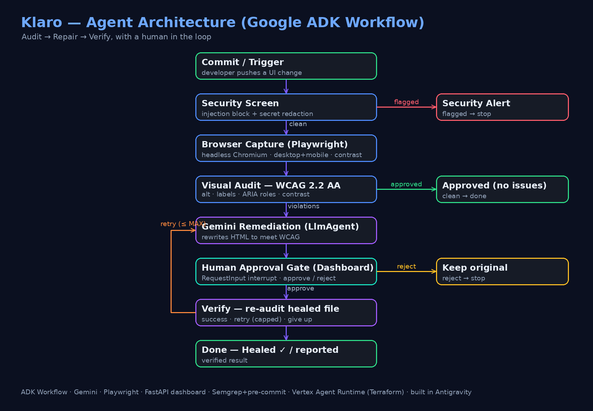

# Klaro — Autonomous UI-Vision QA & Self-Healing Accessibility Agent

> Klaro opens your page in a real browser, finds the accessibility bugs that never throw an error,
> fixes them with Gemini, waits for a human to approve, and then re-checks its own work.

Built for the Kaggle "AI Agents: Intensive Vibe Coding" capstone, **Agents for Good** track.
Stack: Google **ADK 2.0**, **Gemini**, **Playwright**, a FastAPI dashboard, vibe-coded in **Antigravity**.

## The problem

A lot of accessibility bugs are invisible to the people shipping them: a missing `alt`, an input
with no label, an invalid ARIA role, grey text on a slightly different grey. None of them throw an
error, so the build passes and the page goes live broken for anyone using a screen reader or a
keyboard. Manual QA catches it, but it's slow and it's the first thing cut under deadline. So the
bugs pile up, and the bolt-on "accessibility widgets" people buy don't fix the actual code.

## What it does

Klaro runs the loop a human reviewer would, automatically: look at the rendered page, decide what's
wrong, fix it, and verify the fix, with a person approving before anything ships.



*Figure 1 — Klaro's ADK workflow.*

How the graph runs, node by node:

1. **Security screen** checks for prompt-injection and scrubs leaked secrets before anything runs.
2. **Browser capture** loads the page in headless Chromium, takes desktop and mobile shots, and
   measures contrast in the live DOM (with the correct large-text threshold).
3. **Visual audit** checks the DOM for missing `alt`, unlabeled inputs, and invalid ARIA roles,
   then routes "approved" or "violations."
4. **Gemini remediation** rewrites the HTML to fix the issues without changing the layout.
5. **Human approval gate** pauses and shows you the violations, both screenshots, and a before/after
   diff, then waits for approve or reject.
6. **Verify** writes the fix, re-audits the healed file, and retries (capped) or gives up.

## Course concepts used

| Concept | Where | How |
|---|---|---|
| Agent / ADK | Code | `Workflow` graph of `@node`s plus a Gemini `LlmAgent` |
| Human-in-the-loop | Code | `RequestInput` interrupt and `/resume`; Vertex/in-memory sessions, no DB |
| Security | Code | Injection screen, secret redaction, Semgrep, pre-commit |
| Agent skills / CLI | Code | `agents-cli` scaffold and an `accessibility-auditor` skill |
| Deployability | Code/Video | Terraform, Vertex Agent Runtime, OpenTelemetry |
| Antigravity | Video | Built in Google Antigravity |
| Browser tool use | Code | Headless browser is the agent's eyes |

## Run it

```bash
agents-cli install
uv run playwright install --with-deps chromium   # required for the audit
uv run python -m app.ambient_service             # serves http://127.0.0.1:8080
```

Open http://127.0.0.1:8080/, click Run audit, review the issues and the proposed fix, and Approve.
Klaro applies the change, re-audits, and reports clean. Use Next 5 to work through the 20 seeded
demo cases.

The heal step calls Gemini, so it needs Google Cloud auth: `gcloud auth application-default login`.
The audit and screenshots work without it.

## Configuration

| Variable | Purpose | Default |
|---|---|---|
| `GOOGLE_CLOUD_PROJECT` | GCP project for Vertex AI | auto-detected |
| `GOOGLE_CLOUD_LOCATION` | Vertex location (use `global` to avoid model 404s) | `global` |
| `MAX_HEAL_ATTEMPTS` | retries before the agent gives up | `3` |
| `LOGS_BUCKET_NAME` | GCS bucket for telemetry | off |

Copy `.env.template` to `.env` and add your own values. Don't commit `.env`; it's gitignored.

## Tests

```bash
uv run pytest tests/unit          # security/audit logic and a graph-validity check
uv run pre-commit run --all-files # unit tests plus a Semgrep secret scan
```

`tests/unit/test_workflow_graph.py` imports `root_agent`, so an invalid graph fails the test. A
pre-commit hook runs the unit suite and Semgrep on every commit.

## Layout

```
app/
  agent.py              # the ADK workflow graph
  ambient_service.py    # FastAPI: /trigger, /resume, /next-batch, serves the dashboard
  agent_runtime_app.py  # Vertex Agent Runtime entrypoint, telemetry, feedback
  dashboard/index.html  # the review UI
  case_library.py       # 20 seeded violations, served 5 at a time
  mock_app/             # demo target and generated snapshots
tests/                  # unit, integration, eval
deployment/terraform/   # infra
docs/                   # writeup, video script, architecture diagram, dossier
```

## A note on scope

Automated tools, this one included, catch roughly a third to a half of WCAG issues. The rest needs
human judgment, which is why the approval gate is there. For production I'd put a mature engine like
axe-core behind Klaro and keep Klaro as the fix-and-verify layer.

## Deploy

```bash
gcloud config set project <your-project-id>
agents-cli deploy
```

## License

CC-BY 4.0 (the capstone winner license). See `LICENSE`.

## Links

- Video: <ADD YOUTUBE URL>
- Repo: <ADD PUBLIC REPO URL>
